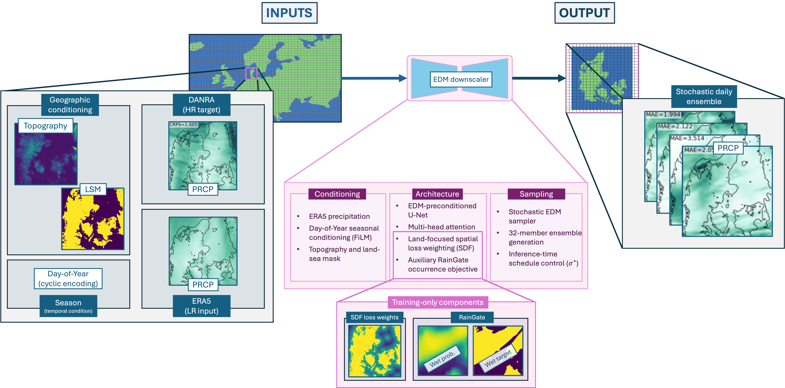

# CEDDAR

**Controllable Ensemble Diffusion Downscaling for Atmospheric Rainfall**

Stochastic EDM-based downscaling of daily ERA5 precipitation to 2.5-km DANRA-scale
precipitation over Denmark.



[Source archive](https://doi.org/10.5281/zenodo.18643186) ·
[Trained models and example data](https://doi.org/10.5281/zenodo.18643307) ·
[GitHub releases](https://github.com/TheaQG/CEDDAR/releases) · [MIT license](LICENSE)

## Overview

CEDDAR learns a conditional generative mapping from ERA5 to DANRA-scale daily
precipitation using an Elucidated Diffusion Model (EDM). Seasonal context,
topography and land-sea information condition a stochastic downscaler that
produces 32-member ensembles.

The associated revised GMD manuscript is:

> **CEDDAR v1.0.2: Evaluating stochastic diffusion-based precipitation
> downscaling beyond pointwise skill**
>
> Thea Quistgaard, Tanja Denager, Raphael J. M. Schneider, Jesper R. Christiansen,
> Simon Stisen and Peter L. Langen. Manuscript DOI: pending.

The revised evaluation examines deterministic skill, event detection,
probabilistic calibration, precipitation climatology, spatial structure, temporal
persistence and $\sigma^{*}$ sensitivity, with bilinear ERA5 and quantile mapping
as benchmarks. These diagnostics assess complementary properties of generated
precipitation beyond pointwise accuracy.

**Version scope.** v1.0.2 identifies the manuscript's model and original source
archive. This checkout includes the revised evaluation and previously audited
$\sigma^{*}$ implementation fixes; the trained weights and architecture are
unchanged. The scientific implementations and final figure settings are now
frozen. This checkout is prepared for software release **v1.1.0**, with publication
pending; see the [release notes](docs/RELEASE_NOTES.md).

## Repository structure

| Location | Purpose |
| --- | --- |
| [`sbgm/`](sbgm/) | Model, training, sampling, transforms and scientific configurations |
| [`revision_evaluation/`](revision_evaluation/) | Revised metrics and validation of saved physical fields |
| [`revision_manuscript_plots/`](revision_manuscript_plots/) | Final data loaders, derived-data generators, panels and figures |
| [`bash_paper1/run_manuscript_figures.sh`](bash_paper1/run_manuscript_figures.sh) | Final manuscript figure runner |
| [`repro/`](repro/) | Portable launchers, smoke checks, bundled statistics and archive tooling |
| [`baselines/`](baselines/) | Benchmark implementations |
| [`data_analysis_pipeline/`](data_analysis_pipeline/) · [`era5_download_pipeline/`](era5_download_pipeline/) | Input-data preparation |
| [`figures/`](figures/) | Existing manuscript image assets, including Figure 1 above |

The final model is `B1_GSDF_RGBCE`. Its
[model configuration](sbgm/config/component_study/B1s/B1_GSDF_RGBCE.yaml) and
[final test/evaluation configuration](sbgm/config/component_study/F_final_test_eval.yaml)
are retained under `sbgm/config/`. Trained weights are distributed separately.

## Installation and small example

Use **Python 3.11** and an environment outside the checkout. For Linux CPU or GPU
installations, first select the matching PyTorch wheels using the
[environment guide](repro/README.md#environment).
From the repository root:

```bash
python3.11 -m venv ../ceddar-env
source ../ceddar-env/bin/activate
# Linux: install the platform-specific PyTorch wheels here (see guide).
python -m pip install -r requirements.txt
python -m pip check
bash repro/01_small_test/run_small_test.sh
```

The [small example](repro/01_small_test/README.md) uses synthetic inputs and random
weights for a bounded CPU inference check. It needs no data download and performs
no training; its scores are installation checks, not manuscript skill estimates.
For an archived checkpoint and real inputs, use the
[real-artifact smoke workflow](repro/02_real_artifact_smoke/README.md).

## Reproducing the manuscript figures

Extract the **compact manuscript figure-data archive** outside the checkout.
It contains saved diagnostics, selected physical examples and provenance;
plotting requires no checkpoint, inference or access to full ERA5/DANRA datasets.
With the environment active, run:

```bash
DATA_ROOT=/absolute/path/to/CEDDAR_manuscript_figure_data \
OUT=/absolute/path/to/figures \
bash bash_paper1/run_manuscript_figures.sh
```

This creates main **Figures 2-7** and supplementary **Figures S5-S10**, each as
PNG and PDF. Figure 1 and S1-S4 were manually prepared. `REPO` defaults to the
checkout; `OUT` defaults to a sibling `CEDDAR_manuscript_figures` directory.
Relative overrides resolve from the invocation directory.

The compact archive was checked against the full data tree: all 12 PNGs matched
the final outputs exactly, and PDFs matched apart from timestamp metadata.
See the [archive workflow](repro/MANUSCRIPT_FIGURE_DATA.md) for manifests,
checksums, dependency tracing and guarded reproduction. Generating new diagnostics
from saved ensembles is a separate workflow under `revision_evaluation/` and
`revision_manuscript_plots/data/`; useful
[$\sigma^{*}$ investigation workflows](docs/SIGMA_INITIALIZATION_DRIVER.md) are retained.

## Data, trained models and releases

| Resource | Location |
| --- | --- |
| Original v1.0.2 source code | [Zenodo: 10.5281/zenodo.18643186](https://doi.org/10.5281/zenodo.18643186) |
| Trained B0/final-model weights and `Data_DiffMod_small` | [Zenodo: 10.5281/zenodo.18643307](https://doi.org/10.5281/zenodo.18643307) |
| Compact manuscript figure data | [Zenodo: 10.5281/zenodo.23369324](https://doi.org/10.5281/zenodo.23369324); DOI reserved, publication pending |
| Revised source release (v1.1.0) | [GitHub releases](https://github.com/TheaQG/CEDDAR/releases); publication and new source DOI pending |
| Manuscript | GMD manuscript DOI pending |

The figure-data archive contains derived products and does not replace source
reanalyses. Source data are available separately through
[DANRA v0.5](https://doi.org/10.5281/zenodo.17294180) and the
[Copernicus Climate Data Store](https://cds.climate.copernicus.eu/).
See the manuscript and Supplementary Information for scientific methods and data
preparation; optional preprocessing dependencies are in
[`requirements-preprocess.txt`](requirements-preprocess.txt).

## Citation

Please cite the associated manuscript and the archived software version used.
[`CITATION.cff`](CITATION.cff) contains the prepared v1.1.0 software citation
metadata; its DOI will be added after publication.
Until the revised release and manuscript citations are assigned, the original
software record is:

```bibtex
@software{quistgaard_ceddar_2026,
  author    = {Quistgaard, Thea},
  title     = {{CEDDAR v1.0.2}: Controllable Ensemble Diffusion
               Downscaling for Atmospheric Rainfall (Code)},
  year      = {2026},
  publisher = {Zenodo},
  doi       = {10.5281/zenodo.18643186},
  url       = {https://doi.org/10.5281/zenodo.18643186}
}
```

## License

Source code is released under the [MIT license](LICENSE). Consult the individual
data records for their terms of use.
